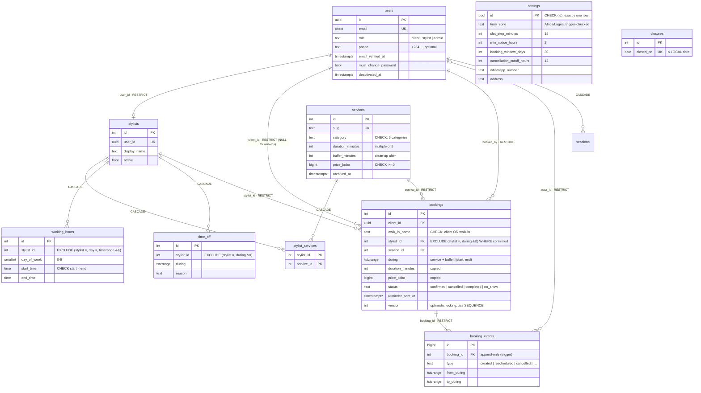
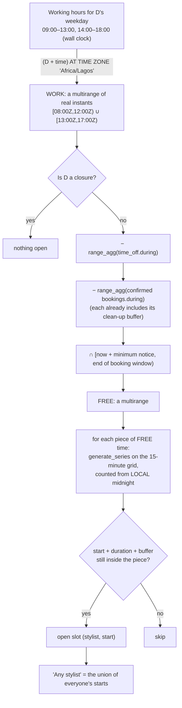
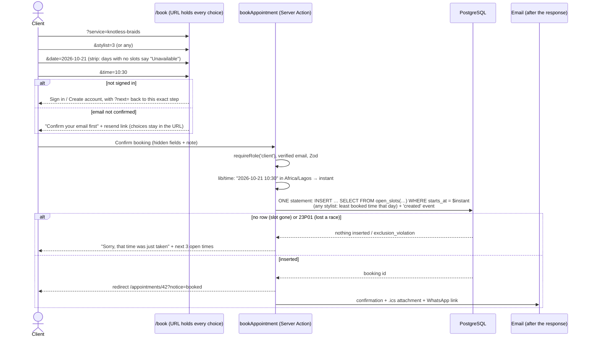

# Ìpàdé

**Ìpàdé** ("meeting" or "appointment" in Yoruba) is an appointment booking app for a hair and beauty studio in Lekki Phase 1, Lagos.

- **Clients** sign up and choose a service (knotless braids, barbing, gel nails, makeup…). They pick a stylist or "any available stylist", choose an open time, and get a confirmation email with a calendar file. They can reschedule or cancel up to the studio's cut-off.
- **Stylists** see only their own day and week, mark appointments completed or no-show, and book their own time off.
- **The admin** runs everything:
  - services, stylist accounts, working hours, closures and settings;
  - a day view of every stylist side by side;
  - every booking, with filters;
  - booking for walk-in and phone clients.

Day 19 of a 30-day build challenge. The focus is **auth and scheduling**. Day 17's hand-built auth is reused for three roles. On top of it come time zones, working hours, available slots, ownership checks on every record, and bookings that **the database itself** guarantees can never overlap.

Built with Next.js 16 (App Router, Cache Components), TypeScript (strict, `noUncheckedIndexedAccess`), Tailwind CSS v4, PostgreSQL on Neon (plain SQL, no ORM), Zod and Resend. There are no auth, date, UI, form or state libraries.

---

- [Run it locally](#run-it-locally)
- [Demo logins](#demo-logins)
- [Deploy to Vercel](#deploy-to-vercel)
- [Three diagrams](#three-diagrams)
- [The database](#the-database)
- [No double booking](#no-double-booking)
- [How time zones are handled](#how-time-zones-are-handled)
- [Who can do what](#who-can-do-what)
- [Ownership checks](#ownership-checks)
- [EXPLAIN: the slot query and friends](#explain-the-slot-query-and-friends)
- [What changed when reusing the Day 17 auth](#what-changed-when-reusing-the-day-17-auth)
- [Design and accessibility](#design-and-accessibility)
- [Concepts and where they live](#concepts-and-where-they-live)
- [Things learned along the way](#things-learned-along-the-way)
- [Not built (yet)](#not-built-yet)

---

## Run it locally

You need Node 22.18 or newer and a free [Neon](https://neon.tech) project.

1. **Install:** `npm install`
2. **Environment:** copy `.env.example` to `.env.local` and fill it in.
   - `DATABASE_URL`: the **pooled** connection string (Neon → Connect → "Connection pooling" on; the host contains `-pooler`).
   - `DATABASE_URL_UNPOOLED` (optional): the direct string. Migrations and the seed prefer it.
   - `SEED_ADMIN_PASSWORD`, `SEED_STYLIST_PASSWORD`, `SEED_CLIENT_PASSWORD`: any passwords of 8 to 128 characters for the demo accounts.
   - `CRON_SECRET`: a long random string (`node -e "console.log(crypto.randomBytes(32).toString('hex'))"`).
   - `RESEND_API_KEY` (optional): without it, every email (confirmations, reminders, verification links, **including the .ics attachment**) is printed in the terminal.
3. **Create the tables:** `npm run db:migrate`. Run it again any time; with nothing new it does nothing.
4. **Add the demo studio:** `npm run db:seed`. It's safe to run twice: the second run changes nothing.
5. **Start:** `npm run dev`, then open <http://localhost:3000>.

| Script | What it does |
| --- | --- |
| `npm run db:migrate` | Applies new files in `db/migrations/` in order, each in its own transaction, recorded in `schema_migrations` |
| `npm run db:seed` | Settings, 13 services, 4 stylists with hours and a lunch break, time off, public holidays, 5 clients and ~200 bookings over the past and next two weeks |
| `npm run db:explain` | Query plans for the slot query and the other hot queries, on the seed and again with 50,000 extra bookings (rolled back) |
| `npm run check:contrast` | Checks 43 colour pairs in both themes against WCAG AA |
| `npm run typecheck` | Regenerates route types, then `tsc --noEmit` |

## Demo logins

After `npm run db:seed`, every account has a confirmed email. Passwords come from your `.env.local`; they are never in the code.

| Email | Role | Password from |
| --- | --- | --- |
| `admin@example.com` | admin | `SEED_ADMIN_PASSWORD` |
| `stylist@example.com` (Funmi, braids) | stylist | `SEED_STYLIST_PASSWORD` |
| `kunle@`, `ijeoma@`, `bisi@example.com` | stylist | `SEED_STYLIST_PASSWORD` |
| `client@example.com` (Tolulope) | client | `SEED_CLIENT_PASSWORD` |
| `amaka@`, `seun@`, `zainab@`, `chidi@example.com` | client | `SEED_CLIENT_PASSWORD` |

## Deploy to Vercel

1. Push the repository to GitHub and import it in Vercel. The framework is detected automatically.
2. Add the environment variables below in **Settings → Environment Variables**.
3. Run the migrations and the seed against the production database once, from your machine: put its URL in `.env.local`, then run `npm run db:migrate` and `npm run db:seed`.
4. The cron job in `vercel.json` is picked up on deploy (Settings → Cron Jobs shows it).

| Variable | Required | Value |
| --- | --- | --- |
| `DATABASE_URL` | yes | Neon **pooled** connection string |
| `DATABASE_URL_UNPOOLED` | no | Neon direct string (only the scripts use it) |
| `APP_URL` | yes | e.g. `https://ipade.vercel.app`, no trailing slash. Email links and the .ics `UID` are built from it, never from the request's Host header |
| `CRON_SECRET` | yes, for reminders | A long random string. Vercel Cron sends it as `Authorization: Bearer …`; without it the reminder route refuses to run |
| `RESEND_API_KEY` | no | A Resend key (`re_…`). Without it, emails go to the function logs |
| `EMAIL_FROM` | with Resend | e.g. `Ìpàdé <bookings@yourdomain.ng>` (a domain verified in Resend) |
| `SEED_ADMIN_PASSWORD`, `SEED_STYLIST_PASSWORD`, `SEED_CLIENT_PASSWORD` | for the seed | Demo passwords |

**The reminder cron job** (`vercel.json`: `0 17 * * *`, which is 17:00 UTC, 18:00 in Lagos) calls `/api/cron/reminders` once a day. It emails every client who has an appointment **tomorrow** in the studio's time zone.

- **Timing limits on the free (Hobby) plan:**
  - cron jobs can run at most **once a day**;
  - Vercel fires them at some point **within the scheduled hour**, not at the exact minute.
- That suits "see you tomorrow". A "two hours before" reminder would need a paid plan (jobs every few minutes) or another scheduler.
- The route is safe to call twice. It *claims* bookings (`reminder_sent_at`) in the same statement that selects them, before sending. Each email also carries a Resend `Idempotency-Key`.

---

## Three diagrams

### 1. The database



### 2. How open slots are worked out

All of this happens in **one SQL function**, `open_slots(service, stylist or NULL, local date)` (`db/migrations/011` and `012`). The same function feeds the date strip, the time grid and the server-side re-check inside the booking `INSERT`, so what's shown and what's accepted can't drift apart.



### 3. The booking flow



---

## The database

Plain SQL in numbered migrations:

- `001`–`005` are Day 17's auth tables, copied unchanged.
- `006` turns users into clients, stylists and admins.
- `007`–`011` are the studio and its schedule.
- `012` is a fix found with `EXPLAIN` (see below).

**Every table, column, constraint and index has a comment in its migration saying why it exists.** The short version:

| Table | Why it exists |
| --- | --- |
| `settings` | One row (`id boolean PRIMARY KEY CHECK (id)`) holding the studio's time zone and booking rules, so the admin can change them without a deploy and `open_slots()` reads them in the same query |
| `services` | The menu. `price_kobo bigint` (whole kobo, no floats); `buffer_minutes` is clean-up time nobody else can be booked into; `archived_at` instead of deleting |
| `stylists` | One row per stylist user: the name clients pick and whether they're taking bookings. The login stays in `users` |
| `stylist_services` | Who offers what. A composite primary key, so a pair can't be stored twice |
| `working_hours` | Weekly **rules** in wall-clock time ("09:00–13:00 on Tuesdays"); several blocks a day make a lunch break |
| `time_off` | A stylist away for a stretch of **real time** (`tstzrange`) |
| `closures` | Whole studio days shut, as **local dates** |
| `bookings` | The appointment: a `tstzrange` that includes the buffer, price and duration copied at booking time, status, version |
| `booking_events` | The append-only history of each booking: who did what, when, and from/to times for a reschedule |

**`ON DELETE`, chosen deliberately:**

| Foreign key | Choice | Why |
| --- | --- | --- |
| `bookings.client_id`, `booked_by`, `cancelled_by` → users | RESTRICT | A booking must keep saying whose it was and who changed it. Users are **deactivated**, never deleted (so there's no "delete account") |
| `bookings.stylist_id` → stylists | RESTRICT | Stylists with history are taken off the booking page (`active = false`), never deleted |
| `bookings.service_id` → services | RESTRICT | Services with bookings are **archived**. Delete is offered only for a never-booked service, and the database decides (23001 → "Archive instead") |
| `booking_events.booking_id`, `actor_id` | RESTRICT | History can't be removed by deleting what it describes |
| `stylists.user_id` → users | RESTRICT | Same reason as above |
| `working_hours`, `time_off`, `stylist_services` → stylists/services | CASCADE | They only describe a stylist or service and mean nothing alone |
| `time_off.created_by` → users | RESTRICT | Users are never deleted |
| Day 17's `sessions`, `email_tokens` | CASCADE | Unchanged |

**Constraints that do real work:**

- the exclusion constraints below;
- `bookings_one_kind_of_client`: either a client account or a walk-in name, written with `IS [NOT] NULL` on both sides, because a CHECK passes on NULL (Day 18's lesson);
- `bookings_cancel_fields`: `cancelled_at` is set exactly when the status is cancelled;
- `bookings_duration_fits`;
- half-open range shape checks;
- a trigger that rejects an unknown time zone;
- an append-only trigger on `booking_events`.

**Indexes for the real queries:**

| Index | Query |
| --- | --- |
| `bookings_no_overlap` (GiST, partial: confirmed only) | The constraint's own index; `open_slots` reads a stylist's confirmed bookings for a day through it |
| `bookings_stylist_during_idx` (GiST `stylist_id, during`) | A stylist's week, the admin day view (every status) |
| `bookings_client_start_idx` (`client_id, lower(during) DESC`, partial) | A client's upcoming and past bookings |
| `bookings_reminder_due_idx` (partial: confirmed, not yet reminded) | The reminder job; it only holds rows still waiting, so it stays tiny |
| `bookings_start_idx`, `bookings_service_idx` | The admin list ordered by start; the RESTRICT check when deleting a service |
| `working_hours_no_overlap`, `time_off_no_overlap` | The exclusion constraints' indexes double as lookups by stylist (and weekday) |
| `stylist_services_service_idx`, `services_menu_idx` | "Who offers this service?"; the live menu by category |

## No double booking

```sql
CONSTRAINT bookings_no_overlap EXCLUDE USING gist (stylist_id WITH =, during WITH &&)
  WHERE (status = 'confirmed')
```

"No two **confirmed** bookings for the **same** stylist (`=`) may **overlap** (`&&`)." `btree_gist` lets one GiST index handle the integer `=` alongside the range `&&`.

**What it does that a check in the app cannot.** Two clients press "Book" for 10:30 with Funmi at the same moment:

- An app-side check ("SELECT for a clash, then INSERT") runs in both requests before either inserts. Both see the slot free, and both insert.
- The constraint is enforced **inside the database as each row is written**. PostgreSQL makes the second writer wait for the first, then fails it with `23P01 exclusion_violation`.
- It also protects every other path: an admin edit, a script, a future feature, a bug.

This was proven with a script: two transactions both ran the "is it open?" check (both said yes), then both inserted. The first committed, and the second was refused with **23P01 `bookings_no_overlap`**. In the browser, two clients confirmed the same slot at the same time from two signed-in browsers. One landed on their booking; the other saw *"Sorry, that time was just taken"* with the next three open times, focus on the message, and the database held exactly one booking.

The rest of the booking rules:

- **The browser's slot is never trusted.** `createBooking` runs `INSERT … SELECT … FROM open_slots(…) WHERE starts_at = $requested`, so the re-check and the insert are one statement. A hand-made request for a closed hour inserts nothing.
- **"Any available stylist"** picks, among the stylists free at that start, the one with the **least booked time that day**, then the lowest id. That spreads work fairly and makes the choice predictable. If a race takes that stylist, it retries (up to 3 times), and `open_slots` then offers the next free stylist.
- **Rescheduling** is one guarded `UPDATE` of `during`, plus its event, in one statement:
  - the booking is checked for scope, status, version and the cut-off;
  - the new time must be in `open_slots(…, ignore this booking)`;
  - it's a single row, so the old time is freed and the new one taken **together**; the client never holds both, or neither.
- **Time off** can't overlap itself (`time_off_no_overlap`). It's also refused over existing confirmed bookings, checked in the same `INSERT`.
  - Known limit: PostgreSQL can't `EXCLUDE` across two tables, so a booking made in the very same instant as a time-off entry could slip in.
  - The other way round is impossible, because `open_slots` subtracts time off.

## How time zones are handled

- **Every moment is a `timestamptz`** (stored as UTC): bookings, time off, sessions, events.
- **The studio's zone is data**, in `settings.time_zone` (`Africa/Lagos`). Every time shown or typed is in that zone, whatever the visitor's phone or the server says. A client in London booking their visit home must see Lagos times, and Vercel's servers run in UTC.
- **Why not hard-code "+01:00"?** Lagos has no daylight saving and has been UTC+1 since 1964, but:
  - countries change their rules (the IANA tz database ships updates);
  - a studio might open a branch elsewhere;
  - an offset belongs to an **instant in a zone**, not to the zone.

  So the code always asks "what's the offset in this zone at this moment?" (`Intl.DateTimeFormat` in `lib/time.ts`, `AT TIME ZONE` in SQL), and reads the zone from settings every time.
- **"10:00 every Tuesday" vs an instant.** Working hours are a **rule** in wall-clock time (`day_of_week`, `start_time`, `end_time`): they name a different instant every week, and which one depends on the zone. They become instants only inside `open_slots`, for one date at a time: `(date + start_time) AT TIME ZONE tz`. Closures are local **dates** for the same reason. Time off and bookings are real **instants**.
- **One module, `lib/time.ts`**, does every conversion in JavaScript with small named functions:
  - `zonedToInstant(date, time, tz)` converts in two passes, so it would also be right across a daylight-saving change;
  - `localDateOf`, `todayIn`, `addDays`, `dayOfWeek`, `startOfLocalDay`;
  - `formatDateTime`, `zoneLabel`.

  No date library is needed: `Intl` knows every zone's rules.
- **Tested** with the server started as `TZ=America/New_York` and the browser emulating `Asia/Tokyo`: the time grid matched `open_slots` in Lagos time exactly ("Friday 30 October, 11:15 AM").
- **Calendar files** use UTC (`20261021T093000Z`), so the client's calendar shows the right moment in their own zone.

## Who can do what

| Action | Client | Stylist | Admin |
| --- | --- | --- | --- |
| Browse services, stylists and open times | ✓ | ✓ | ✓ |
| Sign up (always creates a client) | ✓ | – | – |
| Book for themselves (email must be confirmed) | ✓ | – | – |
| Book for a walk-in or phone client (no minimum notice) | – | – | ✓ |
| See a booking | own | own (assigned to them) | all |
| Download its .ics file | own | own | all |
| Reschedule | own, before the cut-off | – | any, any time |
| Cancel | own, before the cut-off | – | any, any time |
| Mark completed / no-show (once started) | – | own | any |
| See a day / week schedule | – | own | all stylists |
| Add / remove time off | – | own | – |
| Services, stylist accounts, hours, closures, settings | – | – | ✓ |
| Create stylist accounts (temporary password), change roles, deactivate users | – | – | ✓ (not themselves) |

## Ownership checks

How it's enforced: **in the SQL, from the session.** `lib/booking/access.ts` builds a `Viewer` from the session (user id, role, and for a stylist their stylist id). Never from the URL or a form. `bookingScope(viewer)` adds the owner condition to the query's `WHERE`:

- client: `b.client_id = $me`
- stylist: `b.stylist_id = $myStylistId`
- admin: `TRUE`

Every booking read and write includes it. Someone else's booking therefore returns **zero rows**, which pages and routes turn into a **404**: the same answer as for an id that doesn't exist, so nothing leaks. Under Cache Components a page has already started streaming a 200 by the time it can check. So `proxy.ts` runs the same rule (one indexed lookup) for `/appointments/<id>` before rendering, and answers a real 404.

Every check, by place:

| Where | Session | Role | Ownership |
| --- | --- | --- | --- |
| `proxy.ts` | cookie present for signed-in areas (optimistic) | – | `/appointments/<id>…`: `bookingVisibility()` → real 404 if not yours |
| `/appointments` | `requireRole('client')` | client | `listClientBookings(user.id)` |
| `/appointments/[id]` | `verifySession()` | any | `getBooking(viewer, id)` with `bookingScope` → `notFound()` |
| `/appointments/[id]/calendar.ics` (route handler) | `authorizeRequest(…)` → 401 | 403 for a temporary password | `getBooking(viewer, id)` → 404 |
| `/appointments/[id]/reschedule` | `requireRole('client','admin')` | client, admin | `getBooking(viewer, id)` → 404 |
| `bookAppointment` action | `requireRole('client')` | client | the booking is created for `user.id` from the session; email verified (action + SQL) |
| `cancelBookingAction` | `verifySession()` | stylists refused | `cancelBooking`: `WHERE id AND bookingScope AND version AND cut-off` |
| `rescheduleBookingAction` | `verifySession()` | stylists refused | `rescheduleBooking`: same, plus `open_slots` |
| `markBookingAction` | `verifySession()` | clients refused | `markBooking`: scope + started + version |
| `/stylist`, `/stylist/week` | `requireStylist()` | stylist | stylist id from the session; `bookingScope` |
| `/stylist/time-off` + actions | `requireStylist()` | stylist | `WHERE stylist_id = mine` on list, insert and delete |
| `/admin/**` pages and every admin action | `requireRole('admin')` | admin with a confirmed email | admin scope |
| `/api/cron/reminders` | `Authorization: Bearer CRON_SECRET` (constant-time compare) → 401 | – | – |
| Account pages and actions (Day 17) | `verifySession()` | any | `WHERE user_id = me` (sessions, password) |

Tested in the browser:

- As a client: someone else's booking page, its `.ics`, its reschedule page, `/appointments/999999` and `/appointments/abc` all answer **404**. The client's own booking answers 200.
- As a stylist: a colleague's booking is a 404, and `/admin/**` redirects to `/stylist?denied=role`.

## EXPLAIN: the slot query and friends

`npm run db:explain`, after adding **50,000 bookings** across 200 extra stylists (in a transaction that is rolled back). Trimmed to the lines that matter.

**`open_slots` for one day, "any stylist".** The SQL function is **inlined** into the caller (it's a single `STABLE` `SELECT`), so this is its real plan. Each stylist's confirmed bookings come from the exclusion constraint's own GiST index, time off from its own, and working hours by weekday from theirs:

```
GroupAggregate (actual time=0.164..0.172 rows=14 loops=1)
  ...
  ->  Bitmap Index Scan on working_hours_no_overlap (actual time=0.006..0.006 rows=8 loops=1)
        Index Cond: (day_of_week = '3'::smallint)
  ->  Bitmap Index Scan on stylist_services_service_idx
        Index Cond: (service_id = 5)
  SubPlan 2
    ->  Index Only Scan using time_off_no_overlap on time_off t (actual time=0.005..0.005 rows=0 loops=1)
          Index Cond: ((stylist_id = wh.stylist_id) AND (during && tstzrange(day_start, day_end)))
  SubPlan 3
    ->  Index Scan using bookings_no_overlap on bookings b (actual time=0.015..0.016 rows=3 loops=1)
          Index Cond: ((stylist_id = wh.stylist_id) AND (during && tstzrange(day_start, day_end)))
  ->  Function Scan on generate_series slot (actual time=0.006..0.006 rows=7 loops=2)
Execution Time: 0.254 ms
```

The whole 31-day date strip (`generate_series` × `open_slots`) takes **1.5 ms**. More plans:

```
--- A stylist's bookings in one week
  ->  Index Scan using bookings_stylist_during_idx on bookings b (actual time=0.045..0.059 rows=21 loops=1)
        Index Cond: ((stylist_id = 3) AND (during && tstzrange(now(), (now() + '7 days'::interval))))
Execution Time: 0.089 ms

--- A client's bookings, newest first
  ->  Index Scan using bookings_client_start_idx on bookings b (actual time=0.012..0.221 rows=200 loops=1)
        Index Cond: (client_id = '31ca7cfa-…'::uuid)
Execution Time: 0.264 ms

--- Tomorrow's reminders still to send
Index Scan using bookings_reminder_due_idx on bookings b (actual time=0.007..0.008 rows=3 loops=1)
  Index Cond: ((lower(during) >= (now() + '1 day'::interval)) AND (lower(during) < (now() + '2 days'::interval)))
Execution Time: 0.026 ms
```

**A fix this found:** the first version compared `wh.day_of_week = EXTRACT(DOW FROM p_day)`. `EXTRACT` returns `numeric`, so every row was cast and filtered (`Filter: ((day_of_week)::numeric = '3'::numeric)`, `Rows Removed by Filter: 10`). Migration `012` casts the one computed value instead (`::smallint`), and the weekday became an index condition.

## What changed when reusing the Day 17 auth

**Copied** (following Day 17's "How to reuse this auth", from the Day 18 copy so its fixes came along):

- `lib/db.ts` and `lib/auth/*` (including Day 18's `temp-password.ts`)
- `users.ts`, `rows.ts`, `validation.ts`, `safe-redirect.ts`, `next-errors.ts`, `user-agent.ts`, `db-errors.ts`, `action-helpers.ts`, `money.ts`, `url.ts`, `phone.ts`, `theme.ts`
- `proxy.ts`, `app/logout/route.ts`, the `(auth)` pages and actions
- the account pages, `components/forms/*`
- migrations `001`–`005` (unchanged) and `scripts/migrate.mts`

**Day 18 fixes brought over:**

- Confirmation dialogs wrap Tab inside the dialog and return focus to the button that opened them.
- Empty live regions take no space.
- `authorizeRequest()` gives route handlers 401/403 instead of redirects.
- Both 23001 and 23503 are read as "still referenced".
- CHECKs are written with explicit `IS NOT NULL`.
- Users are deactivated instead of deleted, with `must_change_password` for admin-created accounts.

**Changed for this app:**

1. **Three roles:** `client`, `stylist`, `admin` (migration `006`), plus an optional `phone` (normalised to `+234…`).
2. **Sign-up is open again** (Day 18 had closed it), and the role is the literal `'client'` in SQL, never read from the form.
   - Sign-up and login carry `?next=`, so a client halfway through booking comes back to the same step.
3. **Stylists are created by an admin only:** user + `stylists` row + service links + audit event, in one statement, with a random temporary password shown once.
4. **Role changes** on `/admin/users` are client ↔ admin. The stylist role comes with a `stylists` row, so it's managed on `/admin/stylists` (and SQL refuses `stylist` in `setRole`).
5. **`requireRole(...roles)`** takes a list, and sends a wrong role to *their own* home with `?denied=role`.
   - `homePathFor(role)` and a `/start` route send each role to `/appointments`, `/stylist` or `/admin` after login, verification or a password reset.
6. **Emails:** the shared template is in the studio's colours, `sendEmail` gained **attachments** (the .ics) and an **idempotency key**, and the console fallback prints attachments too.
7. **`lib/format.ts` is gone:** it hard-coded `'Africa/Lagos'`. Its helpers moved into `lib/time.ts` and take the zone from settings.
8. **No "delete account"**, as on Day 18: bookings keep their client.
9. **Renames:** cookie `ipade_session`, header `x-ipade-path`, theme key `ipade-theme`, migration lock key, Pwned Passwords user agent.

## Design and accessibility

**Palette: "99J".** 99J is the deep plum-burgundy braiding-extension shade every Nigerian salon keeps by the bundle, next to 1B (off-black). The app takes the salon's materials:

- **99J plum** `#5e1b3f`: primary buttons, the chosen day or time, the active tab and the mark. It's used only for things you press or have chosen.
- **Bone** `#f6f1e9`: the page, a clean salon towel.
- **Charcoal** `#25211f`: text (the 1B shade).
- **Lavender** `#ede5f4`: **open** time slots, selected rows and hovers. It reads as "this is available to you".
- **Dark mode** is deep aubergine `#1a1120`, with soft bone text and a lighter plum `#dba6ca`.

**Booking states**, each with its own colour **and** its own icon shape **and** a word, so none relies on colour:

| State | Look |
| --- | --- |
| Open | lavender, plum text, ⊕ |
| Selected | solid plum, ✓ |
| Booked | slate blue (hue about 210°), a filled dot |
| Unavailable | warm grey with diagonal hatching, – |
| Cancelled | brick red, ✕, struck-through time |
| Completed / success | forest green, ✓ |
| No-show | dashed charcoal outline, ! |

Slate blue is far from both the plum and the (banned) indigo, and the red is a deep brick, never a rose-pink.

**Banned colours:** no peach, tangerine, orange, lime, indigo, teal, rose-pink or canary yellow anywhere.

- Every colour is a `light-dark()` token in the Tailwind v4 `@theme` block (`app/globals.css`).
- Tailwind's default palette is removed (`--color-*: initial`), so off-brand classes don't exist.
- `npm run check:contrast` passes all 43 pairs in both modes.

**Type:**

- **Cormorant Garamond** for headings: a calm, calligraphic serif, like good salon signage.
- **Work Sans** for everything else, with **tabular figures** (the `figures` utility) on every time and price.
- Both were chosen after parsing each font's character map for ₦, Ì, à, é, ọ, ẹ, ṣ and the combining marks, and its GSUB table for `tnum`. Fraunces, Playfair Display, Figtree, Outfit and DM Sans were ruled out (no ₦ or no ọ/ẹ/ṣ), and Mulish and Lexend have no tabular figures.

**The mark** (`components/brand/mark.tsx`) is hand-built SVG: one braid plaited into a loop, sixteen tilted "stitches" alternating plum and lavender over a thin charcoal strand, with the loose end slipping out at the bottom, finished with a cuff bead.

**Accessibility:**

- **Date and time pickers** (`components/booking/slot-picker.tsx`):
  - real buttons with full labels ("Tuesday 21 October, 10:30 AM, available");
  - `aria-pressed` on the choice;
  - unavailable days use `aria-disabled` so they stay findable;
  - **one Tab stop** with arrow-key movement (roving tabindex; Up/Down move a row in the grid, Home/End jump);
  - the choice is announced in a live region;
  - choosing a time moves focus to the confirm step.
- **Forms:**
  - labels, inline errors linked with `aria-describedby`;
  - an error summary that takes focus on submit;
  - "Booking…" while pending;
  - values kept after an error (the hours editor too: React resets a form after its action, so the action returns what was typed).
- **Dialogs:** the cancel dialog traps focus (Tab wraps inside it), starts on the safe "Cancel", and returns focus afterwards.
- **Feedback and focus:** status messages are announced, there's a visible plum focus ring everywhere, and `prefers-reduced-motion` is respected.
- **Theme:** no flash, thanks to a tiny `<head>` script (light/dark follows the OS until you choose).
- **Small screens:** everything was checked at a true 360px with DevTools device emulation: no page scrolls sideways. The admin day view and the stylist week scroll sideways **inside** their own region, under sticky time labels.
- **States:**
  - skeletons while loading;
  - empty states ("No open times on this day. Try Thursday.");
  - a 404 that looks the same for "doesn't exist" and "not yours";
  - a friendly error screen when the database can't be reached. With the database down, the home page still serves from its cache.

## Concepts and where they live

| Concept | File | One-line explanation |
| --- | --- | --- |
| Exclusion constraint (no double booking) | `db/migrations/010_bookings.sql` | `EXCLUDE USING gist (stylist_id WITH =, during WITH &&) WHERE (status = 'confirmed')` refuses overlapping rows inside the database |
| btree_gist and a custom range type | `db/migrations/007_studio_settings.sql` | Lets one GiST index mix `=` on integers with `&&` on ranges; `timerange` for wall-clock blocks |
| Multirange slot maths | `db/migrations/011_open_slots.sql`, `012_…` | Working hours − closures − time off − bookings ∩ window, then a 15-minute grid from local midnight |
| Re-check inside the insert, 23P01 handling | `lib/booking/bookings.ts` (`createBooking`) | `INSERT … SELECT FROM open_slots(…)`; a race becomes "that time was just taken" |
| Atomic reschedule | `lib/booking/bookings.ts` (`rescheduleBooking`) | One guarded `UPDATE` of `during` plus its event: never both times or neither |
| Ownership in SQL | `lib/booking/access.ts` | `bookingScope(viewer)` adds `client_id = me` / `stylist_id = mine` to every booking query → 404 |
| True 404 under streaming | `proxy.ts`, `lib/booking/visibility.ts` | The same rule, checked before rendering, because a streamed page has already sent 200 |
| Role guards | `lib/auth/dal.ts` | `requireRole(...roles)`, `authorizeRequest(...roles)`, `homePathFor(role)` |
| Stylist scope from the session | `lib/booking/access.ts` (`requireStylist`) | The stylist id used in every stylist query comes from the session, never the URL |
| Time zone conversions | `lib/time.ts` | `zonedToInstant`, `localDateOf`, `todayIn`, formatting: all with `Intl`, zone passed in |
| Wall-clock rules vs instants | `db/migrations/009_…sql`, `lib/studio/hours.ts` | Hours are "10:00 every Tuesday"; they become instants only inside `open_slots` |
| Settings as data, cached | `lib/settings.ts` | One row; `'use cache'` + `cacheTag('settings')`, refreshed with `updateTag` on save |
| URL as booking state | `lib/booking/flow.ts`, `app/(site)/book/page.tsx` | Every choice in searchParams: back, refresh and the login detour keep the step |
| Accessible pickers | `components/booking/slot-picker.tsx`, `use-roving-focus.ts` | Real buttons, full labels, roving tabindex, `aria-pressed`, live announcement |
| Calendar file | `lib/booking/ics.ts`, `app/(app)/appointments/[id]/calendar.ics/route.ts` | RFC 5545 by hand: UTC times, stable UID, SEQUENCE = version, line folding |
| Booking emails with attachments | `lib/booking/emails.ts`, `lib/auth/email.ts` | Confirmation, change, cancel and reminder, each with the .ics |
| Idempotent cron | `app/api/cron/reminders/route.ts`, `vercel.json` | `CRON_SECRET` bearer check; claim rows with `reminder_sent_at` before sending |
| Optimistic locking | `bookings.version` in `lib/booking/bookings.ts` | Every change is `WHERE version = seen`; a stale tab is told to reload |
| Append-only history | `db/migrations/010_bookings.sql` (trigger), `booking_events` | Every booking change writes an event in the same statement; old events can't be edited |
| Schedule grid | `components/schedule/schedule-grid.tsx`, `lib/schedule.ts` | Columns of time with blocks positioned by minutes after local midnight; sideways scroll on phones |
| Temporary passwords | `app/(app)/admin/stylists/actions.ts`, `lib/studio/stylists.ts` | Shown once, only the hash stored, `must_change_password` until replaced |
| Money in kobo | `lib/money.ts` | Whole kobo everywhere; `Intl.NumberFormat` → ₦15,000.00 only on screen |
| Query plans | `scripts/explain.mts` | EXPLAIN ANALYZE at 50,000 rows inside a rolled-back transaction |
| Idempotent seed | `scripts/seed.mts` | `ON CONFLICT DO NOTHING` and "only into an empty table"; times converted with `AT TIME ZONE` |

## Things learned along the way

- **A streamed page can't send a 404.** Under Cache Components the static shell goes out with `200 OK` before a page's `notFound()` runs, and the Next.js docs say so plainly. The fix the docs recommend is a check in Proxy, which runs before rendering. Data protection still comes from the SQL scope, so the proxy is only about honest status codes.
- **`EXTRACT` returns numeric.** Comparing it to a `smallint` column casts every row and loses the index. `EXPLAIN` showed it at once; migration `012` fixed it with one `::smallint`.
- **Aggregate before you subtract.** `range_agg(...) - (correlated subquery using a CROSS JOINed CTE)` in one `GROUP BY` fails with "subquery uses ungrouped column". Building the working-hours multirange in its own CTE first fixed it, and reads more like the diagram.
- **`new Date()` during prerender is an error under Cache Components.** The time-zone label (which depends on the current offset) is computed *inside* the cached `getSettings()`. `/book` calls `await connection()`, because its answer depends on "now" anyway.
- **React 19 resets a form after its action runs.** Inputs fall back to `defaultValue`, so an action must send back what was typed for the form to keep it after an error.
- **A rolled-back insert doesn't prove a race.** In the first SQL race test, transaction A rolled back, so B was correctly allowed through. The test has to *commit* A to see B refused with 23P01.

## Not built (yet)

Out of scope today:

- online payments and deposits
- SMS or WhatsApp API messages
- Google Calendar sync
- recurring appointments
- waitlists
- several branches
- automated tests

Worth adding next:

- **Anonymised account deletion** for clients: scrub the name, email and phone, deactivate, and keep bookings for the studio's records.
- **"Two hours before" reminders**, with a scheduler that runs every few minutes (or a paid Vercel plan).
- **No-show policy:** after two no-shows, ask for a deposit or a phone confirmation.
- **Admin moving a booking to another stylist**: today a reschedule keeps the same stylist.
- **Bulk "move these bookings"** when a closure or time off lands on booked days, instead of one at a time.
- **Stopping a client from double-booking themselves** (two overlapping appointments with different stylists): an exclusion constraint on `(client_id, during)`.
- **Service add-ons** (wash before braiding, extra length) that add time and price.
- **Per-service buffers per stylist** (some stylists clean up faster).
- **An `.ics` feed per stylist**, so their phone calendar subscribes to their schedule.
